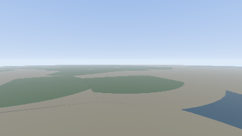

# skybag

An offline electronic flight bag (EFB), written in C++20 with a browser front end. It plans a flight on the WGS84 ellipsoid with winds aloft and a full fuel plan, computes take-off and landing performance by integrating the equations of motion (balanced V1, accelerate-stop, engine-out continued take-off), checks weight and balance against a CG envelope, reads ICAO NOTAMs and closes runways from them, and replays the flight on a moving map with a synthetic terrain view rendered by [terra](#terra), my own globe engine, which is in this repo.

**Simulation only, not for navigation.** The aircraft (the SB-20) is made up, the NOTAM feed and winds are synthetic, and the terrain is procedural. The airport and runway data is real, from [OurAirports](https://ourairports.com/data/) (public domain).



Every claim is a check that measures something against a closed form, a reference or brute force. The ones the engine can't pass yet are listed as known gaps.

```
$ ./build/skybag --check
check                result              value    threshold  measures
isa-table            PASS           2.6469e-06       0.0001  max relative error vs the ICAO standard atmosphere table
geodesic-roundtrip   PASS          6.16349e-06        0.001  max |inverse(direct(s)) - s| over 100k lines up to 15 000 km (m)
geodesic-antipodal   KNOWN GAP          0.7685            0  fraction of near-antipodal pairs where the inverse doesn't converge
navdb-index          PASS                    0            0  radius queries where the grid index != brute force, of 60
wind-triangle        PASS                    0        1e-09  max error on closed-form heading / ground speed cases (deg, kt)
takeoff-balanced     PASS          1.53991e-15        0.001  |OEI distance - ASD| / required at the balanced V1 (66 of 72 cases balanced)
takeoff-step-size    PASS          0.000155511        0.002  required distance, dt 0.05 s vs 0.002 s (relative)
takeoff-monotonic    PASS                    0            0  cases where more mass or a hotter day needs less runway
landing-monotonic    PASS                    0            0  cases where more mass needs less landing distance
wb-envelope          PASS                    0            0  CG envelope point tests that disagree with a winding-number reference
notam-fixtures       PASS                    0            0  NOTAM fixture cases parsed wrong (ids, closures, windows), of 9
terrain-at-field     PASS                    0        1e-06  |terrain - field elevation| at 300 random airports (m)
terrain-corridor     KNOWN GAP         1057.35            1  highest terrain within 10 nm of the route missed by the planner, 4 routes (m)
fuel-short-legs      PASS          0.000713028        0.005  KJFK-EGLL in 50 nm legs: |planned trip fuel - 1 nm reference| / reference
fuel-along-leg       KNOWN GAP      0.00865755        0.005  KJFK-EGLL as one direct leg: |planned trip fuel - 1 nm reference| / reference
fuel-bookkeeping     PASS                    0         0.05  block = trip + contingency + reserve + alternate + taxi, TOW = ZFW + block - taxi (kg)
replay-determinism   PASS                    0            0  same seed different hash, or new seed same hash

0 failed, 3 known gaps (1.1 s)
```

## Build and run

Needs a C++20 compiler (GCC 11+ or Clang 14+), CMake 3.24+ and Python 3 (standard library only). Everything else is in the repo: googletest in `third_party/`, the OurAirports dump in `data/ourairports/`, GeographicLib (only as a test reference) as a wheel in `third_party/python/`. It builds and runs with no network.

```
cmake -S . -B build -DCMAKE_BUILD_TYPE=Release
cmake --build build -j
ctest --test-dir build                       # unit tests + both check tables
./build/skybag --check                       # the table above
./build/skybag serve --port 8080             # then open http://127.0.0.1:8080/
./build/skybag plan KJFK EGLL --zfw 56000    # flight plan in the terminal
./build/skybag takeoff KSFO 28L --mass 72000 --oat 20 --wind 280/12
./build/skybag landing KSFO 28L --mass 62000 --wet
./build/skybag --bench
python3 tools/mutants.py                     # plants bugs, reports what catches each
python3 tools/geodesic_check.py              # geodesics vs GeographicLib (Karney)
./build/terra --check                        # the globe engine's own checks
```

Sanitizers: `-DSKYBAG_SANITIZERS=address,undefined`.

## What's in it

```
navdb      OurAirports CSV (RFC 4180 parser), heliports/closed skipped, runway ends with true
           headings (data, else end-point geometry, else designator), declared distances,
           1-degree grid index for radius and nearest queries, search by ident/IATA/name
geo        Vincenty inverse (from terra) and direct on WGS84, densify along a geodesic
wind       seeded synthetic winds/temperatures aloft (jet stream band + noise), wind triangle,
           runway head/crosswind components
planner    route legs on geodesics, climb/cruise/descent with TOC/TOD (lowers the level when the
           route is too short), drag-polar cruise fuel flow, trip/contingency/final reserve/
           alternate/taxi -> block, TOW <-> fuel fixed point, MTOW/MLW/MZFW/tank warnings
perf       ground roll integrated with thrust lapse, drag, rolling friction and slope; engine
           failure at V1, 2 s reaction, idle + braking + spoilers; air distance to 35 ft from the
           OEI climb gradient; balanced V1 by bisection between VMCG and VR; landing from 50 ft
           with the 1/0.6 dry and +15% wet factors; regulatory 50% headwind / 150% tailwind
wb         stations and arms, CG in %MAC at ZFW/TOW/LDW, envelope test with limit lines inside
notam      ICAO NOTAM fields A/B/C/E, PERM and EST, half-open validity window, runway closures
terrain    terra's procedural planet, flattened to field elevation around airports; route
           clearance and MSA; a brute-force corridor search as the reference
track      ownship replay along the plan with seeded GPS noise, replay hash
http/api   a small HTTP/1.1 server on POSIX sockets and the JSON API for the web UI
web/       plain HTML/JS: flight plan + vertical profile, moving map with replay and synthetic
           view, performance, weight and balance chart, NOTAMs
```

The demo clock is 24 Nov 2026 12:00 UTC, because the synthetic NOTAM feed in `data/notams/notams.txt` is written for that day. At that time KSFO 10L/28R is closed, so asking for take-off performance on 28R says which NOTAM closed it.

## Known gaps

These are the measured weaknesses. They are the roadmap.

1. **Terrain clearance looks only at the waypoints.** `route_clearance` samples the terrain under each waypoint, so a ridge between two waypoints, or terrain off to the side within the corridor, is missed. On four test routes the planner misses up to 1,057 m of terrain inside a 10 nm corridor. The brute-force reference (1 km along, 17 samples across) is correct but too slow to run while a plan is being edited. It also has to stay correct across the antimeridian (RJAA-PANC is one of the test routes) and near the poles.
2. **Fuel on long legs.** The planner evaluates the wind once per leg piece and holds course and mass constant across it. Split into 50 nm legs, KJFK-EGLL is within 0.07% of a 1 nm integration. As one direct leg it is 0.87% off.
3. **Vincenty doesn't converge for nearly antipodal points.** 77% of pairs within half a degree of antipodal fail. The planner refuses such a leg. Karney's algorithm (GeographicLib is vendored only as a checker) is the fix.
4. **The synthetic view is slow.** One 400x225 frame at FL160 over New England takes about 10 s (`skybag --bench`). Every terrain sample does a geodesic nearest-airport query for the flattening, and terra rebuilds every tile every frame.
5. **The tests don't catch everything.** `tools/mutants.py` plants 15 bugs and 12 are caught. Three survive: an accelerate-stop without the reaction time, terrain flattened only at the airport reference point, and an unfactored tailwind.
6. **The moving map is equirectangular around the route.** It is fine for one flight, but it is not a real chart projection, and the airports drawn are only those within 500 nm of the route midpoint.

## terra

`include/terra`, `src/terra`, `tools/terra.cpp` and the `terra_tests` are my globe engine: WGS84 geodesy (ECEF, Vincenty), a quadtree tile pyramid, LOD selection with horizon and frustum culling, procedural planet terrain, and a software rasterizer with a 1/z depth buffer that writes PNGs. skybag uses it for the geodesic inverse, the terrain heights and the synthetic view. `./build/terra --check` runs its own 15 checks (one known gap, pole slivers).

## Data and licences

- Code: MIT, see LICENSE.
- `data/ourairports/`: airports.csv and runways.csv from OurAirports, downloaded 24 Nov 2026, public domain.
- `data/notams/notams.txt`: written for this project, synthetic.
- `third_party/googletest-1.15.2.tar.gz`: BSD-3-Clause.
- `third_party/python/geographiclib-2.0-py3-none-any.whl`: MIT, used only by `tools/geodesic_check.py`.
